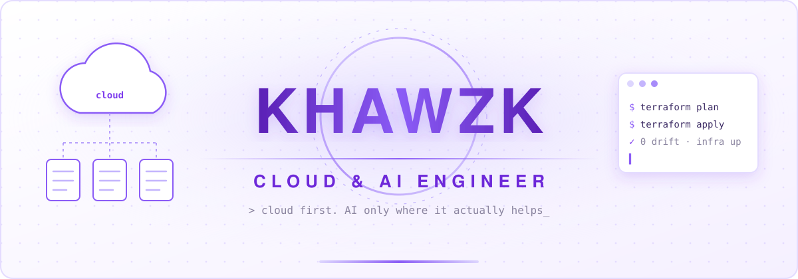

<!-- ═══════════════════════════════════════════════════════════════
     khawzk · GitHub Profile — white × lavender
     Lines marked TODO need your real info.
═══════════════════════════════════════════════════════════════ -->

## 🔥 About Me

Cloud engineer at heart. I design and automate **cloud infrastructure** and **data platforms**, and I bring in **AI** when it solves a real problem, not because it's trendy.

<!-- TODO: add your background, e.g. "Data Science graduate from Universiti Malaya, X years in ..." -->

> Reliable infrastructure first, then the features on top.
> If a script, a SQL query or a rule works, I don't reach for an LLM.
> When AI does earn its place, it ships with cost, latency and monitoring in mind.

## 🎯 Focus Areas

<table>
<tr>

<td width="25%" align="center" valign="top">

### ☁️ Cloud Infrastructure

Infrastructure as code with Terraform, serverless on Cloudflare Workers, and managed AI platforms such as Huawei ModelArts. Every environment should be repeatable, observable and cost-aware.

</td>

<td width="25%" align="center" valign="top">

### 📊 Data Engineering

Hadoop clusters, dbt transformations and SQL analytics. I get the data clean and trustworthy before anyone trains a model on it.

</td>

<td width="25%" align="center" valign="top">

### 🤖 Practical AI

Model routing, RAG and small agents, used only where they beat a simpler solution. I'd rather run the cheapest model that does the job than the biggest one.

</td>

<td width="25%" align="center" valign="top">

### 📱 Apps & Backend

Android apps in Kotlin and REST backends with Spring and MongoDB, plus the APIs that put models in front of users.

</td>

</tr>
</table>

## 🛠️ Tech Stack

| Category | Tools |
|----------|-------|
| **Cloud / DevOps** |      |
| **Languages** |      |
| **AI / ML** |      |
| **Data** |     |
| **Backend / Mobile** |    |

<!-- TODO: remove any badge you don't actually use -->

## 🚀 Featured Projects

### 🤖 Practical AI

| Project | Description |
|---------|-------------|
| [**AISmallRouter**](https://github.com/khawzk/AISmallRouter) | A lightweight router that sends each prompt to the right model. <!-- TODO --> |
| [**AgentDiscovery**](https://github.com/khawzk/AgentDiscovery) | Discovering and orchestrating AI agents. <!-- TODO --> |
| [**ModelStudio**](https://github.com/khawzk/ModelStudio) | A workspace for building and testing models. <!-- TODO --> |
| [**tosagent**](https://github.com/khawzk/tosagent) | A knowledge base and Codex skill for *Tower of Saviors*, built from official notices and Bahamut sources. |
| [**RAG-LLM**](https://github.com/khawzk/RAG-LLM) | Experiments with retrieval-augmented generation. |

### 🛠️ Tools & Apps

| Project | Description |
|---------|-------------|
| [**SGJobRadar**](https://github.com/khawzk/SGJobRadar) | Tracks and surfaces Singapore job postings. <!-- TODO --> |
| [**WhatZkEat**](https://github.com/khawzk/WhatZkEat) | Answers "what should I eat today?" <!-- TODO --> |
| [**Cloudflare-Worker**](https://github.com/khawzk/Cloudflare-Worker) | Serverless utilities on Cloudflare Workers. |
| [**movies**](https://github.com/khawzk/movies) | A pure backend REST API built with Spring MVC and MongoDB, tested in Postman. |

## 🌐 Connect With Me

<!-- TODO: replace the # links with your real profiles, delete the ones you don't use -->

---

> 🔗 **Home base:** [khawzk.github.io](https://khawzk.github.io) ｜ all my projects in one place.
>
> *Solid cloud first. AI only where it earns its place.*

